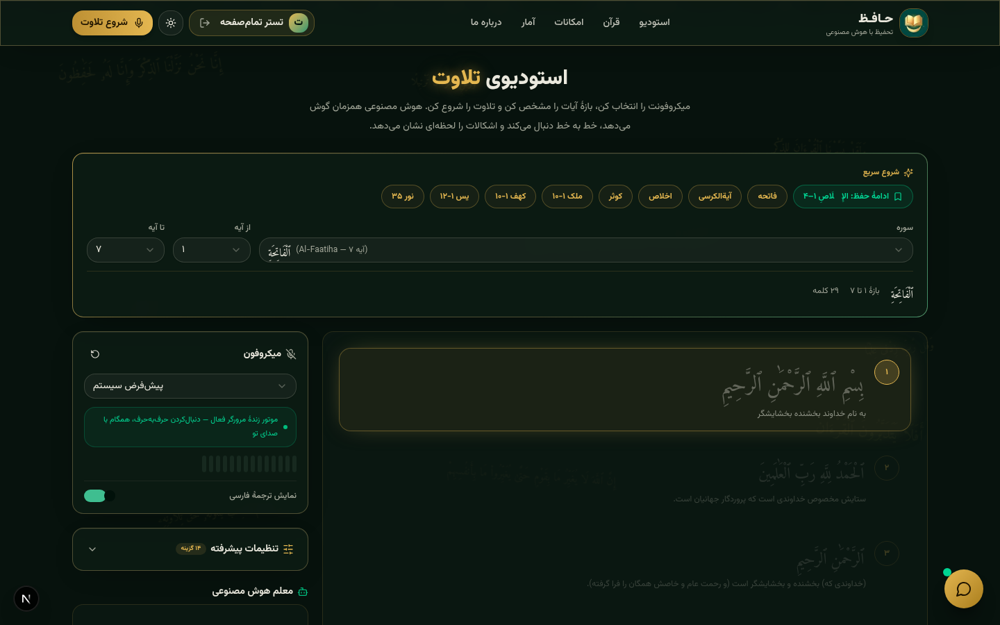
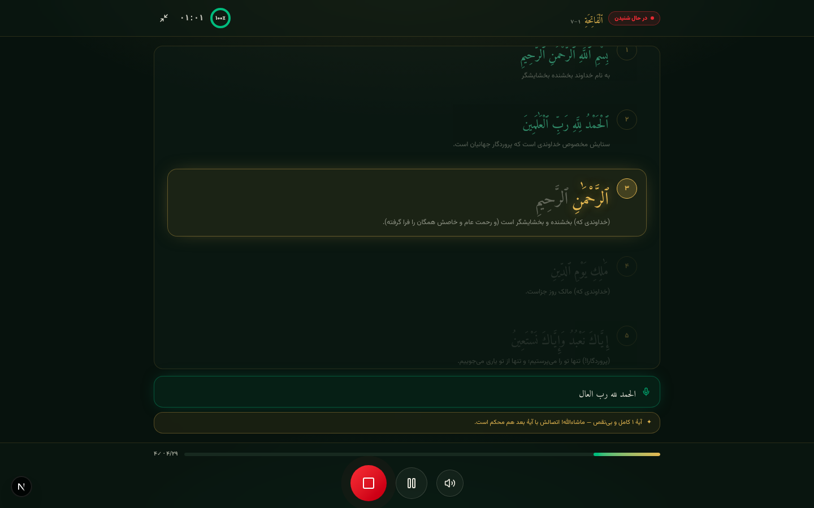
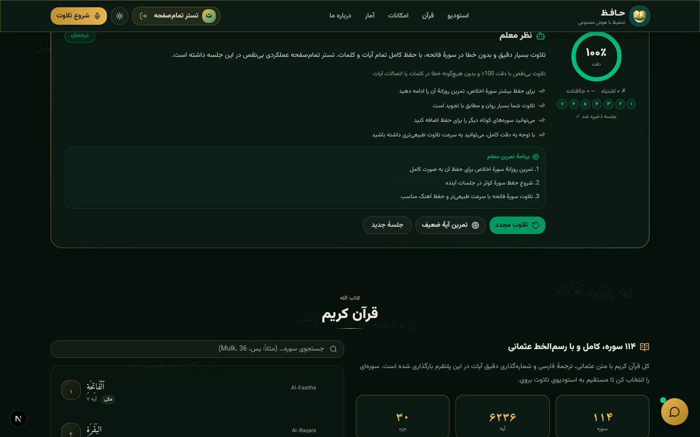

<div align="center">


# 📖 حـافـظ

### استودیوی تلاوت با هوش مصنوعی — قرآن را بلند بخوان، حافظ کلمه‌به‌کلمه دنبالت می‌آید

**AI-Powered Quran Memorization Studio · Live Word-by-Word Tracking · Zero False Errors**

[](https://nextjs.org)
[](https://www.typescriptlang.org)
[](https://teka-quran.vercel.app)
[](https://www.prisma.io)
[](https://teka-quran.vercel.app)
[](https://teka-web-beta.vercel.app)

**[🚀 همین حالا امتحان کن — رایگان و بدون نصب](https://teka-quran.vercel.app)**

</div>

---

<div align="center">

|  |
|:---:|
| *استودیوی تلاوت — هایلایت زندهٔ کلمه‌به‌کلمه، همگام با صدای تو* |

|  |  |
|:---:|:---:|
| *نمای تمام‌صفحه + ترنسکریپت زنده* | *نظر معلم AI + نقشهٔ حرارتی آیه‌ها* |

</div>

## ✨ چرا «حافظ»؟

حافظ قرآن هستی و یک استاد کنارت نشسته که **همان لحظه که کلمه‌ای را جا می‌اندازی یا غلط می‌خوانی، بوق می‌زند** — نه یک ثانیه بعد، نه آخر جلسه. همان لحظه.

اما نکتهٔ اصلی اینجاست: هر اپ دیگری وقتی موتور تشخیص گفتار کلمه‌ای را خراب می‌شنود، تو را مقصر می‌داند. «حافظ» برعکس است — **موتور شنیداری v3 طوری طراحی شده که هیچ‌وقت تلاوتِ درستِ تو خطا شمرده نشود.**

### 🎧 موتور شنیداری v3 — «تأیید دومرحله‌ای»

```
❌ اپ‌های معمولی:  ASR خراب شنید → تو را خطا می‌گیرد → بوق پشت‌سرهم 😡
✅ حافظ:          هر هشدار «دو شاهد مستقل» می‌خواهد:
                   ۱) کلمهٔ ناشناس به هیچ‌کدام از کلمات نچسبد (حتی با تحمل گاربل ASR)
                   ۲) قطعهٔ بعدی تلاوت هم از همان ناحیه عبور کند
                   → فقط در این صورت بوق! وگرنه سکوت کامل.
```

| قابلیت | توضیح |
|---|---|
| 🔤 **مورفولوژی عربی** | كتاب ↔ كتابهم، الناس ↔ ناس — ضمیر و «ال» جابه‌جا؟ مهم نیست |
| 🤫 **حذف‌های ASR بی‌صدا** | اگر تشخیص گفتار کلمه‌ای را نینداخت، هیچ علامتی نمی‌گیری |
| ⚖️ **تبرئهٔ خودکار** | برگشتی و ناحیهٔ مشکوک را دوباره خواندی؟ همهٔ اتهام‌ها پاک می‌شود |
| 🎯 **جانشینی واقعی** | فقط کلمه‌ای که واقعاً از جای دیگر سوره آمده باشد قرمز می‌شود |
| 🧹 **بازبینی سراسری** | پایان جلسه، کل تلاوت یک‌جا هم‌تراز می‌شود و آمار واقعی می‌دهد |
| 📳 **کول‌داون هشدار** | بوق‌ها هرگز پشت‌سرهم نمی‌زنند — حتی در بدترین نویز |

### 🖥 استودیوی تلاوت

- 🎙 **شنیدن زندهٔ کلمه‌به‌کلمه** — هر کلمه همان لحظه که می‌خوانی طلایی/سبز می‌شود
- 📺 **نمای تمام‌صفحه** — با زدن میکروفن، صفحهٔ ثابت باز می‌شود؛ سایت پشتش فریز است و دیگر هیچ تکانی ندارد + **ترنسکریپت زندهٔ** آنچه همین حالا می‌خوانی
- 🚨 **بوق/لرزش/فلاش لحظه‌ای خطا** — قابل تنظیم تا کاملاً بی‌صدا
- 🗺 **نقشهٔ حرارتی حفظ** — چیپ سبز/طلایی/سرخ برای هر آیه در بازبینی
- 🎯 **تمرین هدفمند** — یک دکمه، ضعیف‌ترین آیه را پیدا و فقط همان را تمرین می‌کند
- 🔁 **تکرار خودکار بازه** — تثبیت حفظ با دورهای تکراری
- 🕶 **تمرین کور** — کلمات پیش‌رو پنهان می‌شوند؛ فقط از حفظ بخوان
- 🌍 **۵ لهجهٔ تشخیص گفتار** — سعودی، مصری، امارات، عراق، کویت
- 📊 **آمار واقعی** — دقت، زمان، تاریخچهٔ جلسه‌ها و پیشرفت

### 🤖 معلم هوش مصنوعی

- ✍️ **نظر شخصی معلم** پس از هر جلسه: ریشه‌یابی خطاها، نکته‌های تجویدی (قلقله، نون ساکنه، مدّ واجب…)، برنامهٔ تمرین آیه‌به‌آیه
- 💬 **چت با استاد** — سؤال حفظی داری؟ استاد با پروفایل تو جواب می‌دهد
- 🧭 **مربی زندهٔ آیه‌ای** — هر آیه که کامل شد، همان لحظه تشویق یا راهنمایی می‌گیری

### 📚 قرآن کامل

- 🕌 **هر ۱۱۴ سوره** با رسم‌الخط عثمانی + ترجمهٔ فارسی
- 🎧 **تمرین با قاری** — گوش بده، بعد تکرار کن
- 📝 **آزمون حفظ** — خودت را بسنج
- 🌙 **حالت تاریک/روشن** + PWA قابل نصب روی اندروید و iOS

## 🚀 اجرای محلی

```bash
# پیش‌نیاز: Node 20+ یا Bun
git clone https://github.com/mhmdsdqi87-cloud/TEKA_QURAN.git
cd TEKA_QURAN

# نصب پکیج‌ها
bun install        # یا npm install

# دیتابیس (SQLite + Prisma)
bunx prisma db push

# اجرا
bun run dev        # یا npm run dev
# → http://localhost:3000
```

> 💡 تشخیص گفتار از **Web Speech API** مرورگر استفاده می‌کند — بهترین تجربه با **Google Chrome** (دسکتاپ و اندروید).

## 🛠 معماری فنی

| لایه | تکنولوژی |
|---|---|
| فریم‌ورک | Next.js 16 (App Router) + React 19 |
| زبان | TypeScript 5 (strict) |
| استایل | Tailwind CSS 4 + shadcn/ui + framer-motion |
| موتور شنیداری | Web Speech API + موتور هم‌ترازی سفارشی (DP + ترتیبی + مورفولوژی) |
| هوش مصنوعی | LLM برای نظر معلم و چت حفظی |
| دیتابیس | Prisma ORM + SQLite (+ Turso/libsql برای تولید) |
| مدیریت وضعیت | Zustand + localStorage |

**قلب پروژه** — موتور هم‌ترازی در `src/lib/`:

```
sequencer.ts   → پیگیری ترتیبی کلمه‌به‌کلمه + تأیید دومرحله‌ای شکاف‌ها
alignment.ts   → نرمال‌سازی عربی، مورفولوژی، لوانشتاین+LCS، هم‌ترازی DP
speech.ts      → موتور Web Speech مقاوم‌شدهٔ اندروید (backoff، ضدتکرار، watchdog)
store.ts       → جلسهٔ تلاوت، مربی زنده، خودهمگام‌سازی
```

## 📲 نصب به‌عنوان اپ (PWA)

همین حالا [teka-quran.vercel.app](https://teka-quran.vercel.app) را در کروم اندروید باز کن → منوی ⋮ → **«افزودن به صفحهٔ اصلی»** — اپ حافظ با آیکون اختصاصی نصب می‌شود.

## 🤝 مشارکت

پروژه‌ی متن‌باز است و از هر مشارکتی خوشحال می‌شویم:

```bash
git checkout -b feature/اسم-قابلیت
git commit -m "feat: قابلیت جدید"
git push origin feature/اسم-قابلیت
```

ایده‌ها: TTS تجوید، متشابهات آیات، پلن حفظ هوشمند، زبان‌های بیشتر…

## 👨‍💻 سازنده

<div align="center">

**محمد صادقی** — بنیان‌گذار [گروه TEKA](https://teka-web-beta.vercel.app)
حافظِ قرآن و توسعه‌دهنده؛ «حافظ» را ساخت تا هر کسی، با هر گوشی، یک استاد حفظ شخصی کنارش باشد.

### ❤️ تقدیم به **شعله نعمتی**

> «همهٔ پایهٔ این پروژه مدیون مادرم، **شعله نعمتی**، هستم.
> کمترین کاری که می‌توانستم برایش بکنم، ساختنِ سایتی بود که راحت‌تر به حفظ قرآنش ادامه بدهد.»

*﴿وَقُل رَّبِّ ٱرْحَمْهُمَا كَمَا رَبَّيَانِى صَغِيرًا﴾* — اسراء ۲۴

</div>

## 📄 لایسنس

MIT — آزاد برای همهٔ حفظان قرآن کریم 🌙

<div align="center">

**ساخته شده با ❤️ توسط گروه [TEKA](https://teka-web-beta.vercel.app)**

</div>
